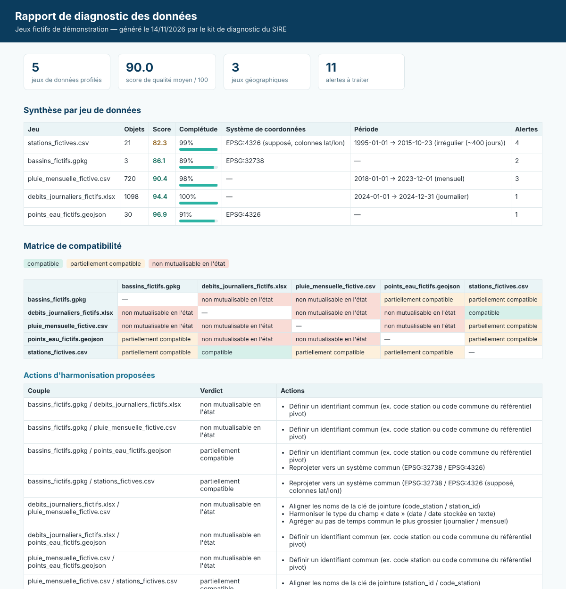

# SIRE Madagascar — démonstrateurs de pré-ingénierie

[](https://github.com/ForOppdrag/sire-madagascar-poc/actions/workflows/tests.yml)
[](LICENSE)

Trois démonstrateurs techniques (POC) accompagnant l'offre d'Oppdrag.tech pour
l'appel d'offres PNUD UNDP-MDG-00895 / PRC0196300 (section 7 du mémoire technique).

> **Neutralité.** Ces démonstrateurs sont des **illustrations méthodologiques**
> réalisées avec des logiciels libres et des données publiques ou fictives.
> Ils ne préfigurent pas le futur SIRE et n'engagent aucun choix technologique :
> le cahier des charges reste rédigé en exigences et en standards.

| POC | Ce qu'il démontre | Section du mémoire | État |
|---|---|---|---|
| [`poc1-interoperabilite`](poc1-interoperabilite) | La fédération des systèmes et les niveaux d'intégration 0 à 4 : une source consultée à la source, des couches répliquées et harmonisées, un catalogue | 3.3, 5, 7 | Code complet ; services Docker à lancer sur le poste |
| [`poc2-diagnostic`](poc2-diagnostic) | Un diagnostic outillé : inventaire et fiche de terrain Excel, profilage de qualité, dictionnaires de données, matrice de compatibilité, fiches ISO 19115, rapport HTML | 3.2, 3.3 | **Fonctionnel et testé** |
| [`poc3-series-temporelles`](poc3-series-temporelles) | L'échange normalisé de séries hydrométéorologiques : CHIRPS lu à la source, agrégé par bassin, contrôlé (lacunes, valeurs aberrantes, indice de sécheresse), publié en OGC SensorThings API et exporté en WaterML 2.0 | 5.2, 5.3 | Chaîne testée sur données synthétiques ; serveur Docker à lancer |

## Prérequis

- Python 3.10 ou plus récent
- Docker avec `docker compose` (POC 1 et 3)
- Accès Internet pour les données publiques (HydroSHEDS, HDX, IRI Data Library)

```bash
python3 -m venv .venv && source .venv/bin/activate
pip install -r poc2-diagnostic/requirements.txt -r poc1-interoperabilite/requirements.txt -r poc3-series-temporelles/requirements.txt
```

## POC 2 — Kit de diagnostic (5 minutes, sans Docker)

```bash
cd poc2-diagnostic
python exemples/generer_exemples.py                 # jeux FICTIFS avec défauts typiques
python -m sire_diag.cli profiler exemples/donnees/* -o rapports/
python -m sire_diag.cli matrice  exemples/donnees/* -o rapports/
python -m sire_diag.cli metadonnees exemples/donnees/stations_fictives.csv \
       --titre "Stations fictives" --organisation "Organisation fictive"
python -m sire_diag.cli rapport exemples/donnees/* -o rapports/rapport_diagnostic.html   # rapport HTML
python -m sire_diag.cli modele-inventaire -o fiche_inventaire.xlsx                    # fiche de terrain
python -m sire_diag.cli importer-inventaire fiche_remplie.xlsx inventaire.sqlite
python exemples/inventaire_exemple.py               # amorce de l'inventaire (SE&AM, Maproom)
python -m pytest -q tests                           # 10 tests
```

Défauts détectés automatiquement sur les jeux fictifs : inversion latitude/longitude,
doublons, valeurs de pluie négatives, dates stockées en texte, systèmes de coordonnées
différents (WGS 84 / UTM 38S), géométrie invalide, pas de temps et périodes
incompatibles, clés de jointure de noms différents (`station_id` / `code_station`).
Des exemples de sorties figurent dans `poc2-diagnostic/exemples/rapports/`, dont un rapport
HTML autonome (`rapport_diagnostic.html`, aperçu ci-dessous). Le modèle Excel d'inventaire,
avec listes déroulantes, sert à la collecte avec les points focaux puis s'importe en une commande.



## POC 1 — Démonstrateur d'interopérabilité

```bash
cd poc1-interoperabilite
cp .env.exemple .env        # puis changer les mots de passe
./demarrer.sh               # données, services, chargement, publication, contrôle de sécurité
# Démonstrateur : http://localhost:8000
```

| Service | Rôle | Niveau d'intégration illustré |
|---|---|---|
| PostGIS + GeoServer (WMS/WFS) | Bassins, rivières et régions chargés dans la base du SIRE après contrôle | 3 répliqué et harmonisé, 4 référence |
| Producteur simulé (pygeoapi, OGC API - Features) | Une institution qui expose elle-même ses points d'eau (fictifs) ; le SIRE les lit sans copie | 2 exposé |
| IRI Data Library (externe, réel) | Pluviométrie CHIRPS consultée à la source | 1 consultable |
| Catalogue (pygeoapi, OGC API - Records) | Fiches de tous les jeux, y compris un jeu sensible seulement catalogué | 0 catalogué |
| Page OpenLayers + nginx | Carte, interrogation des objets, recherche dans le catalogue | — |

Si un téléchargement échoue, `scripts/preparer_donnees.py` indique la page où récupérer
le fichier : placez le zip dans `data/brut/` et relancez. Option `--sans-rivieres` pour
éviter le fichier HydroRIVERS (volumineux).

## POC 3 — Séries temporelles normalisées

```bash
cd poc3-series-temporelles
cp .env.exemple .env && docker compose up -d          # FROST-Server : http://localhost:8081/FROST-Server
python executer.py --debut 2015-01 --fin 2024-12 \
       --sensorthings http://localhost:8081/FROST-Server/v1.1
python -m pytest -q tests                              # 7 tests
```

Sorties : `sorties/pluie_mensuelle_par_bassin.csv`, `sorties/pluie_mensuelle_par_bassin.waterml2.xml`,
`sorties/controle_qualite.html` (lacunes, valeurs suspectes par score z robuste, indice de
sécheresse IPS-3 simplifié par bassin, avec graphique),
et les entités SensorThings (un Thing par bassin, un Datastream par série).
Le POC 3 utilise les bassins préparés par le POC 1 (`poc1-interoperabilite/data/sire.gpkg`).

## Sécurité (repères OWASP appliqués aux démonstrateurs)

- Mots de passe hors du code, dans `.env` (non versionné), refus de démarrer sans eux
- Base de données non exposée sur l'hôte ; administration GeoServer et FROST limitées à `127.0.0.1`
- Mandataire nginx en lecture seule (`GET`/`HEAD`), API REST et interface d'administration de GeoServer non relayées
- En-têtes de sécurité (CSP, `X-Content-Type-Options`, `X-Frame-Options`, `Referrer-Policy`)
- Échappement systématique des données affichées dans la page web (prévention XSS)
- Version de nginx masquée (`server_tokens off`)
- Images Docker paramétrables, dépendances surveillées par Dependabot (chaîne d'approvisionnement, OWASP A03:2025)
- Contrôle automatisé de la pile lancée : `python scripts/verifier_securite.py` (11 contrôles, exécuté par `demarrer.sh`)
- Politique de signalement des vulnérabilités : [`SECURITY.md`](SECURITY.md)

Ces mesures conviennent à une démonstration locale ; elles ne remplacent pas les
exigences de sécurité du futur SIRE (section 6 du mémoire).

## Données et licences

| Donnée | Source | Conditions |
|---|---|---|
| Bassins versants HydroBASINS v1c, rivières HydroRIVERS v1.0 | WWF / HydroSHEDS — hydrosheds.org | Usage libre, citation obligatoire (Lehner et Grill, 2013) |
| Limites administratives COD-AB Madagascar | BNGRC / OCHA — data.humdata.org (cod-ab-mdg) | Voir les conditions du jeu sur HDX |
| Pluviométrie CHIRPS v2.0 mensuelle | UCSB Climate Hazards Center, diffusée par l'IRI Data Library | Citation demandée (Funk et al., 2015) |
| Stations, pluie, débits, points d'eau du POC 2 et du producteur simulé | Générés par `generer_exemples.py` | **Fictifs** |

## Fichiers générés

Les fichiers binaires (GeoPackage, Excel, SQLite) ne sont pas versionnés : ils sont
recréés par `poc2-diagnostic/exemples/generer_exemples.py`, par
`poc2-diagnostic/exemples/inventaire_exemple.py` et par les commandes ci-dessus.

## Licence

© 2026 Oppdrag.tech. Code publié sous la **Licence publique de l'Union européenne
(EUPL) v1.2**, dont le texte figure dans le fichier `LICENSE`. Cette licence libre,
conçue pour le secteur public et disponible dans toutes les langues de l'UE dont le
français, permet aux institutions bénéficiaires de réutiliser et d'adapter ces outils,
tout en garantissant que leurs versions modifiées et redistribuées restent ouvertes.

Les données tierces restent soumises à leurs propres conditions (tableau ci-dessus).

## Ce qui a été vérifié

- Intégration continue GitHub Actions : analyse statique, 20 tests, validation des fichiers Docker Compose, du JavaScript et du script de démarrage, à chaque modification
- POC 2 : 10 tests (profilage, compatibilité, dictionnaire, métadonnées, inventaire, rapport HTML,
  modèle Excel et import), exécution complète de la ligne de commande sur les jeux fictifs
- POC 1 : configurations pygeoapi validées et services testés localement (recherche dans le
  catalogue, lecture des points d'eau) ; préparation des données testée sur des archives au
  format des sources réelles ; contrôle de sécurité testé contre un mandataire simulé ;
  `docker compose config` valide ; JavaScript vérifié
- POC 3 : 7 tests (conversion du temps IRI, agrégation pondérée, WaterML 2.0, charges
  SensorThings, détection de lacunes et de valeurs aberrantes, classes de sécheresse) ; chaîne complète exécutée sur un extrait synthétique
- **Non vérifié ici** (pas de Docker ni d'accès aux sites de données dans l'environnement de
  développement) : démarrage des conteneurs GeoServer, PostGIS et FROST, téléchargements réels,
  validation XSD du WaterML. À faire lors du premier lancement sur le poste.
